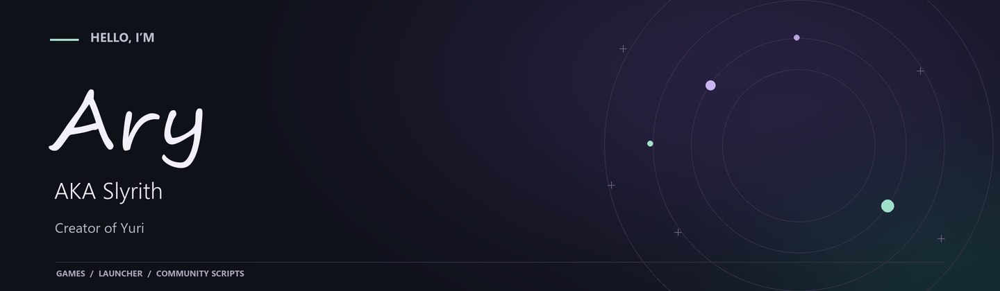

  

<h2 align="center">Ary — AKA Slyrith 🌸</h2>

  <b>Creator of Yuri · she/her</b> 
  I make free game tools and mods under the name Yuri.

  <a href="https://discord.gg/DvP8UxQP3J"><b>Join the community</b></a>
  &nbsp; · &nbsp;
  <a href="https://github.com/Slyrith?tab=repositories"><b>Explore my projects</b></a>
  &nbsp; · &nbsp;
  <a href="https://www.paypal.com/ncp/payment/ZFAGRQRSCT6SQ"><b>Support Yuri</b></a>

 

## My projects

I’m working on game tools, a shared Yuri launcher, and a Lua platform where people can create and share their own scripts. Community suggestions and testing help me decide what to fix and build next.

<table>
<tr>
<td width="50%" valign="top">

### 🌸 [Yuri-Aniimo](https://github.com/Slyrith/Yuri-Aniimo)

My main Yuri project. Tools and modifications for Aniimo, with community feedback guiding fixes and improvements.

[Explore project →](https://github.com/Slyrith/Yuri-Aniimo) &nbsp; [Releases](https://github.com/Slyrith/Yuri-Aniimo/releases)

</td>
<td width="50%" valign="top">

### 🌱 [Yuri-Loftia](https://github.com/Slyrith/Yuri-Loftia)

Tools and modifications for Loftia, including farming automation and convenience features.

[Explore project →](https://github.com/Slyrith/Yuri-Loftia) &nbsp; [Releases](https://github.com/Slyrith/Yuri-Loftia/releases)

</td>
</tr>
<tr>
<td width="50%" valign="top">

### 🖥️ [Yuri Launcher](https://github.com/Slyrith/Yuri-Launcher)

A shared desktop home for Yuri games, packages, updates, profiles, and diagnostics. In development.

[Explore the launcher →](https://github.com/Slyrith/Yuri-Launcher)

</td>
<td width="50%" valign="top">

### 🧩 [Yuri-Lua](https://github.com/Slyrith/Yuri-Lua)

The growing home for the Lua SDK, examples, and community scripts. Built with beginners in mind; the platform is still taking shape.

[Explore Lua →](https://github.com/Slyrith/Yuri-Lua)

</td>
</tr>
</table>

<b>Earlier projects</b>

**[Yuri-Blue](https://github.com/Slyrith/Yuri-Blue)** — my Blue Archive project, now archived. It remains available as part of Yuri’s history.

## Built with the community

Found a bug, have an idea, or want to help test? Come say hello in **[Yuri-enjoyer on Discord](https://discord.gg/DvP8UxQP3J)**. That’s where we share announcements, talk through suggestions, and help each other out. Reproducible issues can also go in the relevant project’s GitHub Issues.

Please check each project’s release notes for supported game versions, available features, and known issues. New game patches can affect compatibility.

 

  <b>All Yuri releases are free. Always.</b> 
  If you’d like to help me keep building, <a href="https://www.paypal.com/ncp/payment/ZFAGRQRSCT6SQ">optional support is appreciated</a>. Thank you for being here ♡

